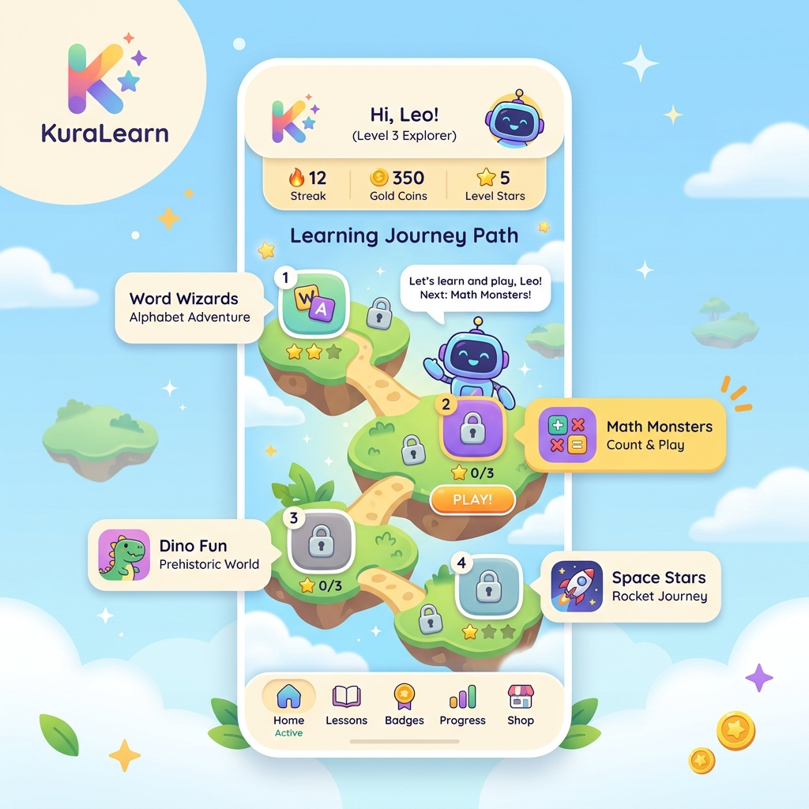
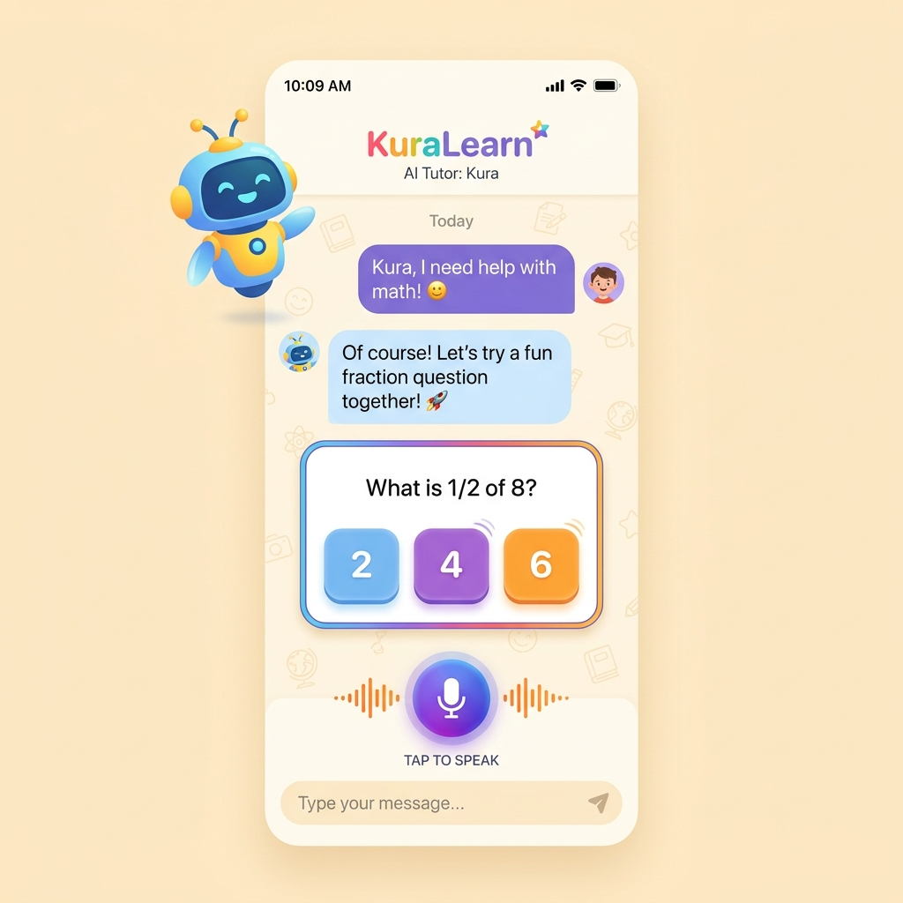
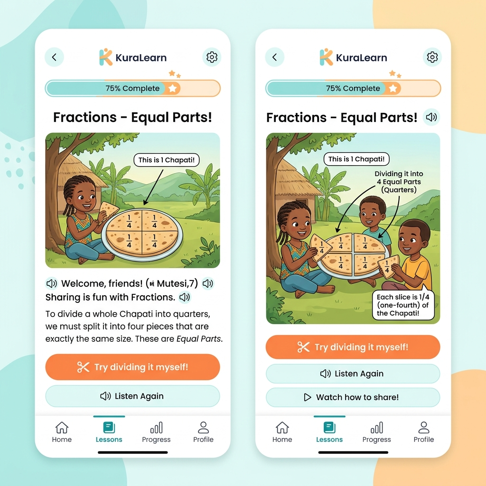
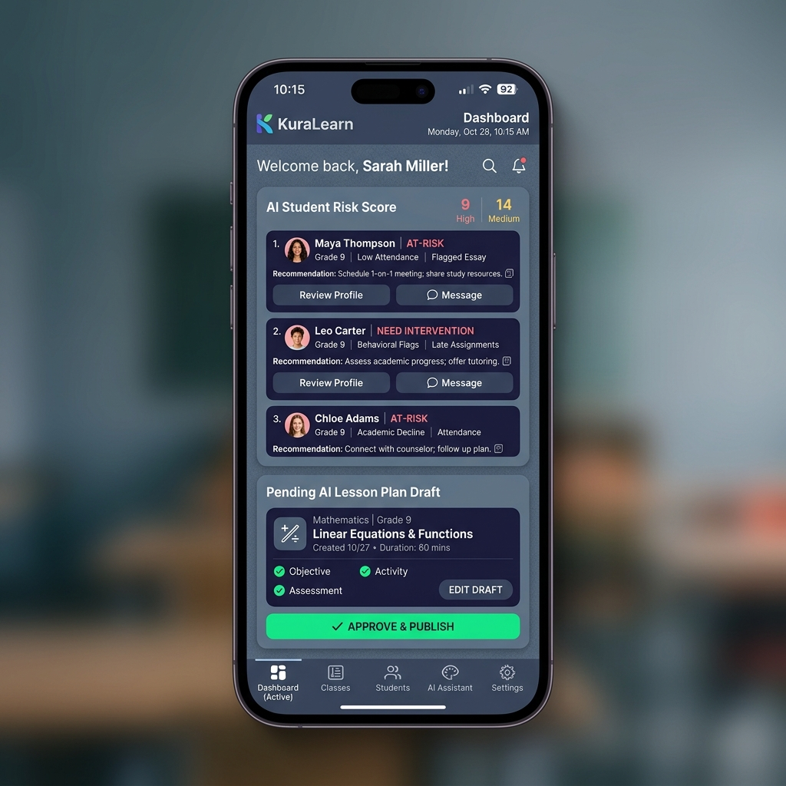

# KuraLearn Mobile App Visual Mockups & Screen Specifications

This document contains high-fidelity visual references and screen layouts for the **KuraLearn Expo React Native mobile application (`KuraLearn-app`)**. Use these local image paths and design specifications to guide UI building.

---

## 1. Student Dashboard (Gamified P1-P3 Layout)

**Local Reference**: `docs/mockups/student_dashboard.png`

### Visual Reference

### Design & Layout Elements
- **Layout Theme**: Rounded components (`rounded-3xl` cards, thick buttons), soft cream-colored background, vibrant bubble accents.
- **Top Bar Status Indicators**:
  - Streak flame badge with counter (e.g., `🔥 12`).
  - Gold coins balance counter with a bounce transition.
  - Level stars indicator counter showing completed stars.
- **Header Section**:
  - Interactive avatar (friendly robot Kura) that speaks welcome notes.
  - Large greeting: "Hi, Leo! (Level 3 Explorer)".
- **Learning Journey Path**:
  - A winding pathway traversing sequential level islands.
  - Floating landmasses representing subjects (e.g., Word Wizards, Math Monsters, Prehistoric Dino, Space Stars).
  - Clean lock icons indicating unlocked vs. locked islands.
  - Interactive play card overlays displaying lesson scores (e.g., `⭐ 0/3`, `PLAY!`).
- **Footer Navigation**:
  - Kid-friendly large custom tab icons (Home, Lessons, Badges, Progress, Shop) with dynamic active indicator states.

---

## 2. AI Voice Tutor Chat Screen

**Local Reference**: `docs/mockups/ai_tutor_chat.png`

### Visual Reference

### Design & Layout Elements
- **Interactive Speech Stream**:
  - Floating dialogue bubbles with deep violet backgrounds for the student and light blue/grey backgrounds for the AI helper (Kura).
  - Modern avatar headshots next to bubbles.
- **Embedded Quiz Cards**:
  - Prominent card inside the chat representing a custom multiple-choice question.
  - Example: "What is 1/2 of 8?"
  - Rounded choice buttons for options (2, 4, 6) in pastel blue, violet, and gold colors.
- **Voice Interactivity Controls**:
  - Centralized voice microphone button at the bottom labeled "TAP TO SPEAK".
  - Floating sound wave indicators around the mic button to represent listening or TTS rendering actions.
  - Sleek text input field with a send icon for typing fallback.

---

## 3. Interactive Lesson Card (Fractions & Equal Parts)

**Local Reference**: `docs/mockups/interactive_lesson.png`

### Visual Reference

### Design & Layout Elements
- **Progress Tracking Header**:
  - High-visibility progress pill displaying current lesson completion state (e.g., `75% Complete`) with an animated star icon.
- **Illustrative Teaching Area**:
  - Localized Rwandan visual contexts (e.g., nursery/primary kids sitting outdoors sharing a traditional circular chapati bread).
  - Mathematical overlays showing chapati bread split into clean, equal quadrants labelled with fractional overlays (`1/4`).
- **Story-driven Text Blocks**:
  - Generous padding and readable large fonts.
  - Custom audio reader speaker icons next to all text passages (Kinyarwanda & English read-aloud triggers).
- **Interactive Action Bar**:
  - High-contrast rounded action buttons (e.g., "Try dividing it myself!", "Listen Again", "Watch how to share!").
- **Footer Navigation**:
  - Clean, simplified secondary student navigation bar.

---

## 4. Teacher AI-Copilot & Analytics Dashboard

**Local Reference**: `docs/mockups/teacher_copilot.png`

### Visual Reference

### Design & Layout Elements
- **Layout Theme**: Professional high-density workspace, elegant dark-accented slate background, deep indigo grids.
- **Header Section**:
  - Welcome text: "Welcome back, Sarah Miller!".
  - Quick utility metrics: Counters for high-risk and medium-risk alert counts.
- **AI Student Risk Alert List**:
  - Stacked roster of student profile cards flagged with predictive risk categories (e.g., `AT-RISK`, `NEED INTERVENTION`) in warning coral/rose tags.
  - Concise analytics bullet logs: Low attendance metrics, behavioral flags, or drop in assignment scores.
  - Action shortcuts: "Review Profile" and direct parent "Message" buttons.
- **Pending AI Copilot Drafting Cards**:
  - "Pending AI Lesson Plan Draft" card showing subject, class grade (Grade 9), plan name, date, and duration.
  - Checklists showing generation phases (Objective, Activity, Assessment).
  - Clear indigo "EDIT DRAFT" button and prominent green "APPROVE & PUBLISH" primary action button.
